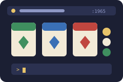

  

# Splendor for a Gemini capsule

  

Didn't work? Create a Studio workspace and paste this to your agent:
` /use-template https://github.com/boweiliu/splendor-for-a-gemini-capsule`

## Why you care

A Gemini capsule is mostly static pages. This skill turns one into a place where two people can play a card game: Splendor, under `/splendor/`, in any Gemini client, with each player identified by their client certificate. It also shows how to put an interactive page next to a stock `bottled-gemini` capsule without giving up agate or the capsule's editor.

## How to use it

You run it from an agent in a Studio workspace, against a capsule you own:

1. You need a Cloud in a Bottle instance running `bottled-gemini` (deployed from a git repo as the app `gemini`), its owner API token as a workspace secret, and a git remote the instance can clone.
2. The agent clones the capsule's repo, copies `files/splendor/` into it, applies `files/hookup.patch` (installs `nodejs`, moves agate to a loopback port and puts a small Node front door on public port 1965), and runs `node --test` on the included tests.
3. It deploys: a dry run as a second app on a spare port, then a swap of the live app with its data kept. The capsule is down for about a minute.
4. It checks from outside: `gemini://<host>/splendor/` answers 20, and a game page without a client certificate answers 60.

Playing: open `gemini://<host>/splendor/`, create a client certificate when the client asks, and choose a game name. A name of the form `:n=2:name` is a two-player game with enforced turns; a plain name is a solo sandbox. The first identity into a game is player 1, the second is player 2, anyone later watches. Moves are short typed commands. Games are saved on the capsule and dropped after 30 idle days.

**The game's own wording is not included.** Every string the game shows that is not from the original web game is a `[BOWEI: ...]` placeholder in `files/splendor/copy.js` (22 of them), written as an instruction. The capsule's owner has to write each one; until then the game shows the placeholders as they are. The tests pass either way.

## Ideas for making it yours

- Add a leaderboard or a "my games" page next to `/splendor/` by extending the front door's handler.
- Port a different small game, or any interactive Gemini page, using the same front door and `hookup.patch` as the pattern.
- Raise or lower the 30-day idle limit and the 300-game cap in `store.js` to fit how busy your capsule is.
- Add a spectator-friendly view that refreshes a finished game into a short replay page.
- Mirror the capsule to a second instance and use the dry-run step as a staging check before every change.

## What this is

This repository is a published **Imbue Studio template**: a clean, bootable
snapshot of what an agent built, ready to adapt into your own. It is NOT the
generic workspace template -- it is this specific project.

[`template.md`](template.md) is the full manifest -- what it is, how it
works, what it needs to run, and what to adapt -- with the
machine-readable half (recipe, requirements, and the environment it needs
installed) in [`template.toml`](template.toml).
